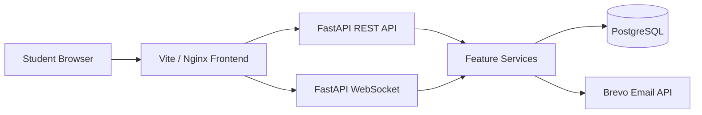

# CampusOne Presentation Guide

## 1. One-minute introduction

CampusOne is a campus-exclusive web application for MANIT students. It combines three daily student services in one authenticated platform:

- Buy and sell items with classmates.
- Report and match lost or found items.
- Communicate in moderated campus chat rooms.

It also provides a campus noticeboard, email-verified authentication, administrator operations, and secure desk verification for lost-and-found handovers.

The application has two major layers:

1. A Vite-built HTML/CSS/JavaScript frontend.
2. A FastAPI backend connected to PostgreSQL through SQLAlchemy.

Authentication uses bcrypt password hashing and JWT access tokens. Email verification and password recovery use expiring one-time passwords delivered through Brevo.

## 2. System architecture



The normal request path is:

```text
Browser -> frontend/js/api.js -> FastAPI router -> service layer -> SQLAlchemy model/session -> PostgreSQL
```

The frontend never talks directly to the database. The backend owns validation, authorization, business rules, persistence, and email delivery.

## 3. Technology choices

### Frontend

- HTML: page structure and forms.
- CSS: responsive visual system and dark/light themes.
- JavaScript ES modules: API calls and UI behavior.
- Vite: local development server and production bundling.
- Nginx: static production serving inside Docker.

### Backend

- FastAPI: HTTP APIs, dependency injection, OpenAPI, and WebSockets.
- Pydantic: request and response validation.
- SQLAlchemy 2: ORM and database sessions.
- PostgreSQL: production relational database.
- Alembic: versioned database migrations.
- bcrypt: password hashing.
- JWT: authenticated sessions.
- Brevo HTTP API: OTP email delivery.

## 4. Frontend file-by-file guide

### `frontend/index.html`

Public entry page. It contains:

- Landing hero.
- Animated ribbon SVG container.
- Login dialog.
- Signup form.
- Email verification form.
- Forgot-password and reset-password forms.
- Home link inside the auth header.

It loads `auth-pages.js` and `landing.js`.

### `frontend/app.html`

Authenticated application page. It contains:

- Application header with hamburger, CampusOne brand, theme toggle, and profile button.
- Profile dropdown with name, email, scholar ID, branch, and logout.
- Services page.
- Buy and Sell card.
- Lost and Found card.
- Community Chat card.
- Separate Noticeboard page.
- Marketplace, lost-and-found, chat, and admin views.
- Modal forms for creating items and changing passwords.

`app.js` protects this page by calling `Auth.requireAuth()`.

### `frontend/js/api.js`

Central API client.

Responsibilities:

- Read the API base URL from `VITE_API_BASE`.
- Use `http://127.0.0.1:8000/api` during local Vite development when no override exists.
- Send JSON requests.
- Attach `Authorization: Bearer <JWT>` to authenticated requests.
- Convert error responses into usable messages.
- Store and retrieve the JWT and current user from `localStorage`.
- Build WebSocket URLs from the API base.

Important exported objects:

- `Auth`: token, session, logout, and route protection.
- `Api`: authentication, product, lost-found, admin, and chat methods.

### `frontend/js/auth-pages.js`

Authentication behavior.

Responsibilities:

- Submit login credentials.
- Submit registration data.
- Move a new registration to OTP verification.
- Resend verification codes.
- Open forgot-password form.
- Request reset OTP.
- Submit reset OTP and new password.
- Open and close the login/signup dialog.
- Switch between login and signup tabs.

### `frontend/js/landing.js`

Decorative only. It generates twelve SVG ribbon paths and animates them with `requestAnimationFrame`. It does not control authentication or business data.

### `frontend/css/style.css`

Shared design-system stylesheet. It contains base typography, buttons, forms, cards, app shell, tables, modals, chat, and authentication layout rules.

### `frontend/css/landing.css`

Landing-page-specific styles. It contains:

- Dark hero theme.
- Lavender accents.
- Serif display typography.
- Auth dialog and auth-card styling.
- Full-screen login/signup overlay.
- Auth top bar and Home link.

### `frontend/css/app-theme.css`

Authenticated application theme. It overrides the shared paper/navy defaults with:

- Dark lavender app theme.
- App header and profile dropdown.
- Services cards.
- Noticeboard cards.
- Marketplace cards and visible prices.
- Dark/light theme variables.
- Sidebar collapse behavior.
- Chat, modal, table, and form colors.

### `frontend/vite.config.js`

Vite configuration.

- Uses `index.html` and `app.html` as the multi-page build inputs.
- Uses port `5173` by default.
- Reads environment variables from the repository environment directory.

### `frontend/package.json`

Frontend package definition.

Commands:

```text
npm run dev
npm run build
npm run preview
```

### `frontend/Dockerfile`

Builds the frontend with Node, then serves the generated static files through Nginx.

### `frontend/nginx.conf`

Nginx configuration for serving the static frontend and fallback routing.

## 5. Backend file-by-file guide

### `backend/app/main.py`

Application entrypoint.

Responsibilities:

- Create the FastAPI application.
- Configure CORS.
- Expose `/` and `/api/health`.
- Register authentication, admin, product, lost-found, and chat routers.

### `backend/app/core/config.py`

Settings layer using environment variables.

Important settings:

- Database URL.
- JWT secret.
- Token expiration.
- Campus email domain.
- CORS origins.
- Brevo API key and sender email.
- OTP expiration.
- Environment mode.

### `backend/app/core/security.py`

Security primitives.

- Hash passwords with bcrypt.
- Verify submitted passwords.
- Create JWT access tokens.
- Decode and validate JWT tokens.

### `backend/app/dependencies.py`

Reusable request dependencies.

- Extract bearer token.
- Decode the JWT.
- Load the current user.
- Reject inactive or invalid users.
- Restrict admin-only operations.

### `backend/app/db/session.py`

Database connection setup.

- Creates SQLAlchemy engine.
- Creates session factory.
- Provides `get_db()` for FastAPI dependency injection.
- Supports SQLite-style local configuration and PostgreSQL deployment configuration.

### `backend/app/db/base.py`

Imports ORM models into SQLAlchemy metadata so migrations and table creation know every model.

### `backend/app/seed.py`

Development seed script. It creates sample users and sample application data for demonstrations.

Do not present real secrets from environment files. Use the seeded demo accounts only in a controlled local demonstration.

## 6. Authentication module

Files:

- `backend/app/modules/auth/model.py`
- `backend/app/modules/auth/schema.py`
- `backend/app/modules/auth/service.py`
- `backend/app/modules/auth/router.py`

### User tables

`users` stores:

- Name.
- Scholar ID.
- Branch.
- Campus email.
- Bcrypt password hash.
- Verification state.
- Role.
- OTP hash and expiry for reset/verification workflows.

`pending_registrations` stores signup data before email verification is complete.

### Authentication endpoints

```text
POST /api/auth/register
POST /api/auth/verify-email
POST /api/auth/resend-verification
POST /api/auth/login
GET  /api/auth/me
POST /api/auth/change-password
POST /api/auth/forgot-password
POST /api/auth/reset-password
```

### Registration flow

1. Student enters name, scholar ID, branch, campus email, and password.
2. Backend validates the email and campus domain.
3. Password is hashed with bcrypt.
4. A six-digit OTP is generated.
5. Only the OTP hash and expiry are stored.
6. A pending-registration record is created.
7. Brevo sends the code.
8. Development mode also logs the code to the backend terminal.
9. Student submits the code.
10. Backend creates a verified `User` and deletes the pending record.
11. Backend returns a JWT.
12. Frontend stores the session and opens `app.html`.

### Login flow

1. Student enters email and password.
2. Frontend sends `POST /api/auth/login`.
3. Backend looks up the user by email.
4. bcrypt verifies the password.
5. Backend creates a JWT whose subject is the user ID.
6. Frontend stores the token and user data.
7. Browser redirects to `app.html`.
8. `Auth.requireAuth()` protects the app page.
9. The app calls `/api/auth/me` to refresh user information.

### Forgot-password flow

1. Student clicks Forgot password.
2. Student enters campus email.
3. Backend generates an OTP for a verified user.
4. OTP hash and expiry are stored on the user record.
5. Brevo sends the OTP.
6. Student enters the OTP and a new password.
7. Backend validates the hash and expiration.
8. Backend replaces the bcrypt password hash.
9. OTP fields are cleared.
10. Student returns to login.

For security, the forgot-password request returns a generic message even when the email does not exist.

## 7. Marketplace module

Files:

- `backend/app/modules/product/model.py`
- `backend/app/modules/product/schema.py`
- `backend/app/modules/product/service.py`
- `backend/app/modules/product/router.py`
- Frontend rendering is in `frontend/js/app.js`.

Endpoints:

```text
GET  /api/products
POST /api/products
PATCH /api/products/{product_id}/status
```

Flow:

1. Marketplace view loads products.
2. Backend returns newest products first.
3. Frontend filters by category and search text.
4. Authenticated users create listings.
5. Product ownership is stored through seller ID.
6. Only the seller can mark a product sold.
7. Price is rendered in bright lavender for dark-card contrast.

Current limitations:

- No purchase transaction.
- No image-upload UI.
- No server-side search or pagination.
- No built-in buyer/seller messaging.

## 8. Lost-and-found module

Files:

- `backend/app/modules/lost_found/model.py`
- `backend/app/modules/lost_found/schema.py`
- `backend/app/modules/lost_found/service.py`
- `backend/app/modules/lost_found/router.py`

Flow:

1. Student reports an item as lost or found.
2. Backend stores the item privately.
3. Backend searches opposite-kind reports.
4. It tokenizes title, description, and location.
5. It calculates Jaccard token similarity.
6. Scores at or above `0.25` become match records.
7. Student sees their own items and matches.
8. Owner requests desk verification.
9. Backend creates a short-lived verification code.
10. Only the code hash is stored.
11. Admin verifies the code at the physical desk.
12. Admin resolves or closes the item.

Similarity formula:

```text
similarity = intersection(tokens_a, tokens_b) / union(tokens_a, tokens_b)
```

This is a deterministic heuristic, not machine learning.

## 9. Community chat module

Files:

- `backend/app/modules/chat/model.py`
- `backend/app/modules/chat/schema.py`
- `backend/app/modules/chat/service.py`
- `backend/app/modules/chat/router.py`
- `backend/app/modules/chat/realtime.py`
- Frontend behavior is in `frontend/js/app.js`.

Endpoints:

```text
GET  /api/chat/{room_name}
POST /api/chat
WS   /api/chat/ws/{room_name}?token=<JWT>
```

Flow:

1. Student opens Community Chat.
2. Frontend opens a WebSocket with the JWT.
3. Backend authenticates the token.
4. Connection is added to an in-memory room.
5. Server sends room history.
6. Student sends a message.
7. Backend validates and persists it.
8. Backend broadcasts the saved message to room members.
9. If WebSocket fails, frontend uses REST polling every five seconds.
10. Leaving the view closes the socket and polling timer.

Important tradeoff: room membership is process-local memory. Multiple backend workers would need Redis or another shared pub/sub system for complete cross-instance broadcasting.

## 10. Admin module

Admin endpoints:

```text
GET    /api/admin/users
DELETE /api/admin/users/{user_id}
```

The frontend reveals the User Management navigation only when the current user role is `admin`. Backend authorization is still required; hiding a menu item is not a security boundary.

## 11. Database and migrations

Tables:

- `users`
- `pending_registrations`
- `products`
- `lost_found_items`
- `lost_found_matches`
- `chat_messages`

Migration files:

1. `backend/alembic/versions/20260725_01_initial_schema.py`
2. `backend/alembic/versions/20260725_02_email_verification.py`
3. `backend/alembic/versions/20260725_03_pending_registrations.py`

Alembic lets the team evolve the schema in ordered, repeatable steps instead of manually editing production databases.

## 12. Docker and deployment flow

`docker-compose.yml` defines:

### Database container

- PostgreSQL 16 Alpine.
- Host port `5433` to container port `5432`.
- Persistent Docker volume.
- Health check with `pg_isready`.

### Backend container

- Port `8000`.
- Waits for healthy PostgreSQL.
- Runs Alembic migrations.
- Starts Uvicorn.
- Health endpoint: `/api/health`.

### Frontend container

- Builds with Node.
- Serves static output through Nginx.
- Uses `VITE_API_BASE` for the backend URL.

Local commands:

```text
docker compose up -d --build
docker compose exec backend alembic upgrade head
docker compose exec backend python -m app.seed
```

## 13. Presentation demo sequence

1. Open the landing page.
2. Explain the campus-only purpose.
3. Open Login.
4. Show the campus email restriction.
5. Show Signup and OTP verification concept.
6. Log in with a seeded/demo account.
7. Show the Services page.
8. Open Buy & Sell and explain product ownership.
9. Show price contrast and category filtering.
10. Open Lost & Found and create a report.
11. Explain similarity matching and desk verification.
12. Open Community Chat and send a message.
13. Show Noticeboard as a separate page.
14. Open the profile dropdown and show student information/logout.
15. Toggle light/dark mode.
16. Collapse and reopen the sidebar/header menu if enabled.
17. Explain Docker Compose and health checks.

## 14. Likely viva questions and answers

### Product and requirements

**Q: What problem does CampusOne solve?**

A: It brings common campus activities into one verified environment: student marketplace, private lost-and-found coordination, campus chat, and useful campus resources. The verified email rule improves trust and keeps the platform campus-specific.

**Q: Why is the application restricted to MANIT emails?**

A: Campus-only access reduces spam and improves trust between buyers, sellers, and students reporting lost items. The backend validates the email domain during registration, so this is not only a frontend restriction.

**Q: What are the three main services?**

A: Buy & Sell, Lost & Found, and Community Chat. They are presented as separate service cards and separate functional views.

### Architecture

**Q: Why separate routers and services?**

A: Routers handle HTTP concerns such as request parsing, dependencies, and response status. Services contain business rules. This keeps route handlers small and makes business logic reusable and testable.

**Q: Why use an ORM?**

A: SQLAlchemy maps Python classes to relational tables, centralizes relationships, parameterizes database operations, and works naturally with FastAPI sessions.

**Q: Why use migrations?**

A: Alembic gives the database a version history. Every schema change is reviewable and can be applied consistently in development, staging, and production.

**Q: Why use Docker Compose?**

A: The app depends on multiple services. Compose gives a repeatable local environment with PostgreSQL, backend, health checks, migrations, and frontend serving.

### Security

**Q: Are passwords stored directly?**

A: No. Passwords are hashed with bcrypt. The database stores only the hash, and login verifies the supplied password against that hash.

**Q: Are OTPs stored directly?**

A: No. The backend stores a SHA-256 hash and expiry timestamp. The raw code is sent to the user and is not persisted as plain text.

**Q: What does the JWT contain?**

A: The token identifies the user through the `sub` claim and contains an expiration time. The backend still loads the user from the database for authorization decisions.

**Q: Is hiding an admin button secure?**

A: No. It is only a UI convenience. Security comes from backend dependencies such as `require_admin`, which checks the authenticated user's role.

**Q: How does password recovery avoid account enumeration?**

A: The forgot-password endpoint returns a generic response whether or not the email exists. This avoids revealing which campus emails have accounts.

### Marketplace

**Q: Who can mark an item as sold?**

A: Only the seller who owns the product. The backend checks ownership before changing status.

**Q: Where does search happen?**

A: The current implementation loads products from the backend and filters them in the browser by search text and category. For a large dataset, server-side filtering and pagination would be a future improvement.

**Q: Are transactions handled?**

A: No. CampusOne currently provides listings and status changes, not payment, checkout, reservations, or transaction settlement.

### Lost and found

**Q: Is matching AI?**

A: No. It is a deterministic Jaccard token-overlap heuristic using title, description, and location. This is transparent and easy to explain, but less powerful than a machine-learning model.

**Q: Why use a score threshold?**

A: The threshold filters weak overlaps and prevents every report from becoming a match. The current threshold is `0.25`.

**Q: Why is admin verification needed?**

A: The platform can suggest a likely match, but physical handover should be controlled by a campus desk. The short-lived verification code helps confirm the handover without exposing a permanent secret.

### Chat

**Q: How is chat real-time?**

A: WebSockets keep a live connection between browser and backend. New messages are persisted and broadcast to everyone in the same room.

**Q: What happens if WebSockets fail?**

A: The frontend falls back to REST history polling every five seconds, so the feature remains usable with reduced real-time performance.

**Q: Can the current chat scale to multiple servers?**

A: REST can scale more easily, but WebSocket room state is stored in process memory. A production multi-instance deployment should use Redis or another shared pub/sub system.

### Frontend

**Q: Why are there two HTML pages?**

A: `index.html` is the public/authentication entrypoint. `app.html` is the authenticated application shell. Separating them keeps the landing/auth bundle independent from the main product UI.

**Q: How is navigation implemented?**

A: The app is a multi-view page. `showView()` adds or removes the `hidden` class for Services, Noticeboard, Marketplace, Lost & Found, Community, and Admin views.

**Q: Why use localStorage?**

A: It keeps the JWT and current user available across page navigation and refreshes. A production application might prefer secure HttpOnly cookies to reduce token exposure to JavaScript.

**Q: Does the landing animation affect business logic?**

A: No. `landing.js` only draws decorative SVG ribbon paths. Authentication and data access are handled by separate modules.

### Operations and limitations

**Q: What happens if PostgreSQL is unavailable?**

A: The backend cannot complete database-dependent requests. Docker Compose uses a database health check and starts the backend after the database becomes healthy.

**Q: How is CORS handled?**

A: FastAPI configures allowed frontend origins from settings. Local ports `5173` and `5174` are included in the development configuration.

**Q: What would you improve next?**

A: Add automated tests, server-side product search and pagination, image uploads, transaction or reservation support, Redis-backed chat scaling, secure cookie-based sessions, rate limiting, and stronger production secret management.

**Q: What testing exists currently?**

A: The frontend build and editor diagnostics were verified. The repository does not currently contain a dedicated application-owned automated test suite, so adding unit, integration, and end-to-end tests is an important next step.

## 15. Strong closing statement

CampusOne is designed around a clear separation of concerns: the frontend provides an approachable campus experience, the FastAPI backend enforces validation and authorization, and PostgreSQL preserves reliable application data. Its strongest product decisions are campus verification, private lost-and-found matching, admin-controlled handover, and graceful chat fallback. Its main next-stage engineering priorities are automated tests, scalable real-time infrastructure, secure production session handling, and richer marketplace workflows.

## 16. Beginner questions you may be asked

### Basic web concepts

**Q: What is a frontend?**

A: The frontend is the part users see and interact with in the browser. In CampusOne it is made from HTML, CSS, and JavaScript. It displays forms, cards, pages, buttons, and messages, then calls backend APIs when data is needed.

**Q: What is a backend?**

A: The backend runs on the server. It receives requests from the frontend, validates them, applies business rules, communicates with the database, and returns a response. CampusOne uses FastAPI for this layer.

**Q: What is an API?**

A: An API is a defined way for software components to communicate. For example, the frontend calls `POST /api/auth/login` with an email and password, and the backend returns either an error or an authentication token.

**Q: What is REST?**

A: REST is a style of HTTP API design. It uses URLs and HTTP methods such as GET for reading, POST for creating, PATCH for partial updates, and DELETE for removal.

**Q: What is a WebSocket?**

A: A WebSocket is a long-lived two-way connection. Unlike a normal request that ends after one response, a WebSocket lets the server push new chat messages to connected students immediately.

**Q: What is JSON?**

A: JSON is a lightweight text format for structured data. CampusOne sends objects such as `{ "email": "student@stu.manit.ac.in" }` between frontend and backend.

**Q: What is HTTP status code 401?**

A: `401 Unauthorized` means authentication failed or a valid token was not supplied. For example, an incorrect login password produces a 401 response.

**Q: What is HTTP status code 404?**

A: `404 Not Found` means the requested URL does not exist on the server. During development, calling `/auth/login` instead of `/api/auth/login` caused this type of problem until the API base path was corrected.

**Q: What is CORS?**

A: CORS is a browser security rule controlling which frontend origins may call a backend. CampusOne configures allowed local frontend origins such as ports 5173 and 5174.

### Programming and project structure

**Q: Why are HTML, CSS, and JavaScript separate?**

A: HTML describes structure, CSS controls appearance, and JavaScript controls behavior. Separating them makes the code easier to maintain and lets the same behavior work with different visual themes.

**Q: What is a JavaScript module?**

A: A module is a file with its own scope that can import and export values. CampusOne uses modules such as `api.js`, `auth-pages.js`, and `app.js` so authentication, API access, and application behavior are separated.

**Q: What is a function?**

A: A function is a reusable block of code that performs one operation. For example, `loadProducts()` requests marketplace data and `showView()` controls which app section is visible.

**Q: What is a dependency?**

A: A dependency is software the project uses instead of implementing everything itself. FastAPI, SQLAlchemy, bcrypt, PyJWT, PostgreSQL, and Vite are examples in CampusOne.

**Q: What is an environment variable?**

A: It is configuration supplied outside source code. Database URLs, API keys, CORS origins, and secret keys are configured this way so environment-specific values are not hardcoded into application logic.

**Q: Why should secrets not be committed?**

A: API keys, database passwords, and JWT secrets can allow unauthorized access. They should be stored in environment configuration or a secret manager, never in public source control.

**Q: What is validation?**

A: Validation checks whether input has the correct shape and values. Pydantic validates fields such as email format, password length, OTP format, and required values before business logic runs.

**Q: What is error handling?**

A: Error handling converts failures into controlled responses. The backend raises HTTP errors with useful status codes, while the frontend displays the returned message instead of crashing.

### Database questions

**Q: What is a database table?**

A: A table stores records of one type. For example, the `products` table stores marketplace listings and the `chat_messages` table stores messages.

**Q: What is a primary key?**

A: A primary key uniquely identifies one database record. User ID, product ID, and message ID are examples.

**Q: What is a foreign key?**

A: A foreign key connects one table to another. A product stores a seller ID that points to a user, and a chat message stores an author ID that points to a user.

**Q: What is a database relationship?**

A: It describes how records are connected. One user can own many products, lost-and-found items, and chat messages, so those are one-to-many relationships.

**Q: Why use PostgreSQL instead of a JSON file?**

A: PostgreSQL provides transactions, constraints, indexes, concurrent access, relationships, and reliable persistence. A JSON file is not appropriate for multiple users updating data at the same time.

**Q: What is a transaction?**

A: A transaction groups database changes so they either all succeed or all fail. This prevents partially completed operations, such as creating a user without finishing the related verification state.

**Q: What is a migration?**

A: A migration is a versioned database schema change. Alembic applies changes such as adding OTP fields or creating pending-registration storage in a controlled order.

### Authentication questions

**Q: Why hash passwords instead of encrypting them?**

A: Hashing is one-way and designed for password verification. Encryption is reversible, which means a leaked encryption key could reveal every password. bcrypt also intentionally makes guessing expensive.

**Q: Why use an OTP?**

A: An OTP proves that the user controls the campus email address and supports both account verification and password recovery without storing a plain recovery password.

**Q: Why does an OTP expire?**

A: Expiration reduces the risk of an old code being reused. CampusOne defaults to a ten-minute OTP lifetime.

**Q: What happens when a JWT expires?**

A: Protected API requests stop being authorized. The frontend should require the student to log in again and obtain a new token.

**Q: Where is the JWT stored currently?**

A: The current frontend stores it in browser `localStorage`. This is convenient for this project, but a production-hardening improvement would be secure HttpOnly cookies with suitable CSRF protection.

**Q: Is frontend validation enough?**

A: No. Frontend validation improves user experience, but it can be bypassed. The backend repeats important validation and authorization checks because the server is the security boundary.

### Feature questions

**Q: Why is the lost-and-found data private?**

A: Privacy reduces false claims and protects students from publicly exposing details about lost belongings. Users see their own reports and relevant matches, while admins manage desk verification.

**Q: Why does an admin verify a lost item?**

A: Automated matching only suggests similarity. A campus desk should confirm the physical handover using a short-lived code.

**Q: Why is chat described as anonymous if a user is authenticated?**

A: Authentication is required for access control and moderation, but the displayed name is a generated first-name-and-branch handle. The backend still retains the real author ID for accountability.

**Q: Why have a REST fallback for chat?**

A: Some networks, proxies, or deployments may block WebSockets. REST polling keeps the feature usable even when real-time delivery is unavailable.

**Q: Why are Services and Noticeboard separate pages?**

A: Services are interactive product features that change application views. Noticeboard is a separate resource area. Separating them reduces visual clutter and makes the app easier to scan.

**Q: What happens when a user logs out?**

A: The frontend removes the JWT and stored user data, then redirects to the public landing page. Subsequent protected requests cannot authenticate without a new login.

### Testing and demonstration questions

**Q: How did you verify the frontend?**

A: The Vite production build was run successfully, editor diagnostics were checked, and browser smoke tests verified login dialog behavior, signup switching, profile interaction, page switching, sidebar behavior, theme switching, and card rendering.

**Q: What tests should be added next?**

A: Add backend unit tests for services, API integration tests for authentication and authorization, database tests for matching and ownership, and Playwright end-to-end tests for login, listing creation, lost-and-found reporting, chat, and password reset.

**Q: How would you test login?**

A: Test valid credentials, invalid credentials, malformed email, missing fields, expired JWT, inactive user, and access to protected routes without a token.

**Q: How would you test password reset?**

A: Test a valid campus email, unknown email with a generic response, expired OTP, incorrect OTP, short password, successful reset, and login with the new password.

**Q: How would you test authorization?**

A: Test a normal user attempting an admin endpoint, a user attempting to edit another seller's listing, and a user trying to access another student's private lost-and-found data.

## 17. Short answers to memorize

**Project summary:** CampusOne is a MANIT-only student platform combining marketplace, lost-and-found, community chat, and campus resources.

**Backend summary:** FastAPI routes requests, service classes apply rules, SQLAlchemy persists data, and PostgreSQL stores it.

**Security summary:** Campus email verification, bcrypt password hashes, expiring hashed OTPs, JWT sessions, and backend role checks protect the system.

**Frontend summary:** Vite serves modular HTML, CSS, and JavaScript pages; `api.js` centralizes communication and `app.js` controls authenticated views.

**Main limitation:** The project needs a dedicated automated test suite and shared infrastructure such as Redis before large-scale multi-instance deployment.

## 18. How campus exclusivity works

The project accepts MANIT student addresses ending with:

```text
@stu.manit.ac.in
```

The exact pattern is not `manit.stu.ac.in`; the student-domain suffix used by this project is `stu.manit.ac.in`.

### What happens during signup

1. The student enters a name, scholar ID, branch, campus email, and password in `frontend/index.html`.
2. `frontend/js/auth-pages.js` creates a registration payload.
3. `frontend/js/api.js` sends it to:

```text
POST /api/auth/register
```

4. `backend/app/modules/auth/schema.py` validates that the email has a valid email format and that the password satisfies its length rule.
5. `backend/app/modules/auth/service.py` applies the campus-domain rule. If the email does not end with `@stu.manit.ac.in`, the backend rejects the registration.
6. The password is immediately converted into a bcrypt hash. The plain password is not stored in the database.
7. The student is not inserted into the permanent `users` table yet. The registration is stored temporarily in `pending_registrations`.
8. The backend generates a random six-digit OTP.
9. The backend hashes the OTP with SHA-256 and stores only the hash plus an expiration time.
10. The backend sends the original OTP to the submitted campus email through Brevo.
11. The frontend switches from the signup form to the verification form.

### Why this proves campus ownership

Checking the domain only proves that the text looks like a MANIT student email. It does not prove that the person owns the mailbox.

The OTP provides the second part of the proof:

```text
Correct MANIT domain + successful OTP entry = verified mailbox ownership
```

Only a person who can open that specific college mailbox should be able to read the OTP and complete registration.

### How the OTP email is sent

The backend uses the Brevo HTTP email API.

The flow is:

```text
FastAPI auth service
    -> generates OTP
    -> hashes OTP for database storage
    -> creates email payload
    -> calls https://api.brevo.com/v3/smtp/email
    -> Brevo delivers email to the @stu.manit.ac.in mailbox
```

Brevo receives configuration from environment variables:

```text
BREVO_API_KEY
BREVO_SENDER_EMAIL
```

The sender email must be verified in Brevo. The API key is sent in the request header and should never be committed to source control.

### What the email contains

The email contains the six-digit verification code and an expiration message. The backend does not put the OTP into the database in plain text.

### Development mode behavior

When `ENVIRONMENT=development`, the backend also prints the OTP in the terminal. This is useful when Brevo is not configured during local development.

This terminal output is only a development convenience. In production, OTPs should be delivered through the configured email provider and should not be logged.

### What happens when the student submits the OTP

1. The frontend sends email and OTP to:

```text
POST /api/auth/verify-email
```

2. The backend finds the pending registration by email.
3. It checks whether the code has expired.
4. It hashes the submitted OTP.
5. It compares the submitted hash with the stored hash.
6. If the hashes match, the backend creates a verified `User` record.
7. The temporary `PendingRegistration` record is deleted.
8. The backend returns a JWT and user information.
9. The frontend stores the session and opens `app.html`.

### What happens for an invalid attempt

- Wrong domain: registration is rejected before an OTP is sent.
- Invalid email format: Pydantic validation rejects the request.
- Wrong OTP: verification fails.
- Expired OTP: verification fails.
- Missing pending registration: verification fails.
- Already-used registration: the pending record no longer exists after successful verification.

### How password recovery uses the same idea

Forgot password also uses the verified campus mailbox:

1. Student enters a campus email.
2. Backend creates an expiring OTP for an existing verified user.
3. Brevo sends the OTP to that email.
4. Student submits the OTP and a new password.
5. Backend verifies the OTP and replaces the stored bcrypt password hash.

The forgot-password request returns a generic message even if the email is not registered. This prevents attackers from discovering which campus emails have accounts.

### Strong presentation answer

> Campus exclusivity is enforced on the backend, not only in the browser. The backend accepts only the `@stu.manit.ac.in` suffix, temporarily stores the registration, generates a six-digit OTP, hashes the OTP, and sends the original code through Brevo to the submitted college mailbox. Registration becomes a permanent verified user only after the student returns the correct unexpired OTP. Therefore the domain restricts the allowed institution and the OTP proves access to the actual mailbox.
